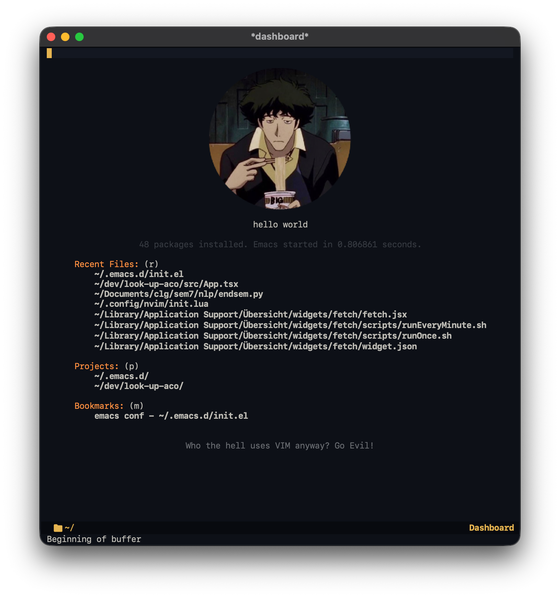
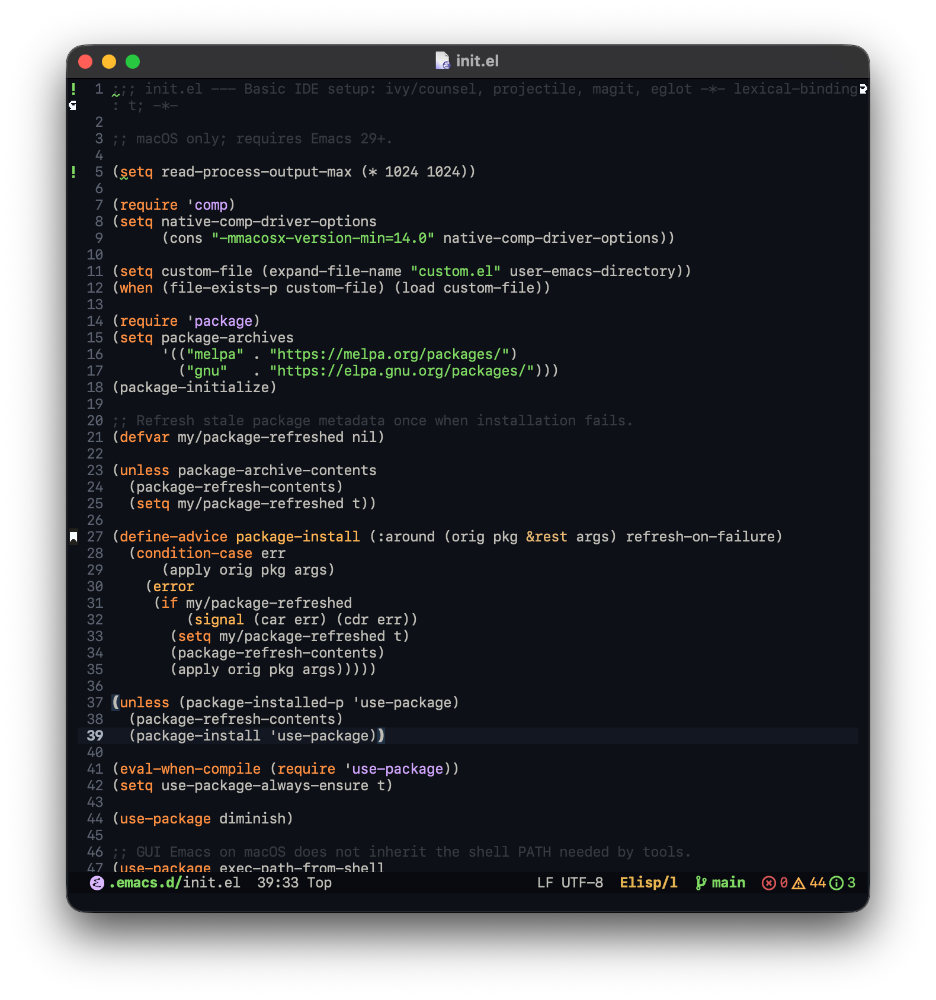

    <h1>emacs <i>riced up</i></h1>
  

    
    
  

## what's this?

a small Emacs config for macOS that looks good and feels snappy: ivy/counsel, projectile, magit, treemacs, eglot (LSP), flymake, format-on-save, and vterm.

requirements
macOS, Emacs 29+ (30 recommended)
SF Mono (or change the font in init.el)
vterm build deps: brew install cmake libtool libvterm
LSP servers for the languages you use, e.g. gopls, rust-analyzer, pyright, clangd, typescript-language-server
optional formatters for apheleia: gofmt, rustfmt, black, prettier

## setup
 
1. back up any existing `~/.emacs.d`, then clone this repo into it.
2. start Emacs. packages install on first launch.
3. run `M-x nerd-icons-install-fonts` once, then restart.
